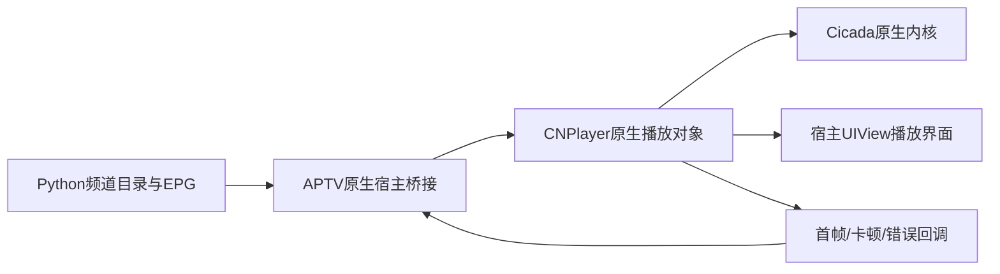

# 随包 CNPlayer iOS 集成手册复核

2026-10-22。用户附件与 IPA 内 `Frameworks/CNPlayerSDK.framework/央视网iOS播放器集成手册.md` 逐字节一致：19,218 字节，SHA-256 `908d2581305dcfe5663cc3754c697345682f15efbaf1a6bda075d3a39407e797`。文档标识 BV3.23.17，日期2025-10-27。上一轮只检查了头文件/模块文件和部分英文文档名称，漏查此中文Markdown手册；“未取得正式集成手册”的结论现予更正。

## 已确认的正式文档内容

| 范围 | 手册证据 | 当前可据此确定的内容 |
|---|---|---|
| 基础工程接入 | 第1–29行 | arm64；CNPlayerSDK/CicadaPlayerSDK/alivcffmpeg；sqlite3/z；`-ObjC -lresolv`；关闭Bitcode；三个framework设置Embed & Sign |
| 启动 | 第30–49行 | `startPlayerSDK_Options:` 与 `defaultOptions`，以及日志配置 |
| 点播与原生视图 | 第51–103行 | VOD起播、configOptions、autoPlay、prepareToPlay、player.view嵌入UIView |
| 生命周期/恢复 | 第105–123行 | prepare/play/pause/reset/stop、移除内核、retry、刷新VDN重试、前后台恢复 |
| 码率与版权 | 第125–142行 | 码率切换；版权检查需先完成起播入口；实际授权由SDK/服务处理 |
| 回调与测量 | 第144–352行 | 加载、播放、VDN、失败、版权、周期及统计事件；有首帧、卡顿开始和恢复事件 |
| 错误分类 | 第354–440行 | VDN/CDN/DRM/内核错误，能区分网络、证书、设备权限及许可文件等失败 |

这是已经取得的随包正式集成说明；其内容仍需与当前二进制和完整SDK交付对应。样本经过修改，文档与包的一致性不等于原始分发签名或第三方使用授权已经认证。

## 需要修正或继续区分的事项

**当前样本的依赖不止手册列出的三个库。** CNPlayerSDK 的 Mach-O 加载命令还直接加载 `xnet.framework/xnet`，故xnet需要纳入本样本的集成依赖核对。Tquic是主App的直接依赖，本次未证明它也是独立SDK的必要依赖。三个库的基本组成不能替代实际二进制依赖清单。

样本CNPlayerSDK的完整framework为16,209,375字节（约15.5MiB），其中Mach-O为14,968,320字节。已核实存在CNLiveConfig_V2th.json、CNPlayerStartPlist.plist和4份cnplayer_live_fallback资源文件；仅复制3个Mach-O文件不能替代完整framework/资源的正式交付。具体文件名及大小已加入元数据摘要，未输出资源中的账号或配置值。

**最低iOS版本按实际交付核对。** 手册写iOS9；本样本CNPlayerSDK的最低版本是10，CicadaPlayerSDK是11，原App是15。仅三库及已见传递依赖的Mach-O下限已达到11，不能按旧手册直接承诺当前样本支持iOS9；正式支持范围还需匹配版本说明和真机验证。

**手册中的VOD方法有两种入口。** 方法列表为实例 `playVODWithVid:...` 返回BOOL；例子为类工厂 `playVODVid:...` 返回播放器对象。样本元数据中两类入口都存在，不能将名称差异误判为签名冲突；也不能互换调用。

**用户另列的UDRM配置/检查接口没有在这份附件中给出正式签名。** 正文没有 `configSDK_CICADA_UDRMUrl:`、`configSDK_IJK_DRMUrl:`、`configSDK_LiveConfig_V2th:`、`configSDK_LiveVDNUrl_V2th:`、`configSDK_HTTP_Origin:` 或 `CNCicadaDRMRightChecker` 的完整接入说明。它们及许可URL属于独立的二进制/配置观察，不能说由此手册正式定义。完整头文件、LIVE起播样例及相应配置/授权说明仍需要补齐。`CNPlayerDefin.h` 在手册中被明确引用，但IPA未发现它。

本轮进一步逐个核对了上述5项配置方法，以及checker的`checkValidate_AppKey:appSecret:completionBlock:`、`processUDRMLicesne_sourceUrl:completionBlock:`、`startSDK`和`registerProtocol`：9项均在对应类的静态方法元数据中存在。配置方法编码返回对象，checker完成回调仅编码为Block；其中不包含Block的完整参数声明、授权语义或线程要求。因此没有把它们拼成可直接执行的许可适配器。观察记录已补入 [IOS-SDK-INTERFACE-OBSERVATIONS.json](IOS-SDK-INTERFACE-OBSERVATIONS.json)，属于运行时证据，不是补造的头文件。

**库内符号能定位分工，不能证明完整职责。** 静态外部定义表中CicadaPlayerSDK有9个`UDRM32_`前缀符号，CNPlayerSDK也导出`UDRM_DecryptSample`。这些证据支持存在原生UDRM相关组件，未验证具体实现、活跃播放路径、全部许可归属或第三方输出能力；本轮未分析实现或调用这些入口。

## 错误码的重要更正

手册第394行定义 `D-80001001 = EX_UDRM_ERROR_CONNNECT_FAILED`，即连接失败；第416行的`D-80002007`才是设备无权，第419行`D-80003001`是取得许可失败。因此旧日志的通用字符串`sdk_license_rejected code=80001001`不能据以断言服务明确拒绝授权。

这是iOS手册的正式映射。当前Python使用的是另一个固定版本Android SDK，其返回码对应关系尚未逐项验证，不能仅因数字相同将整张iOS表自动应用到Android。可以确定的是：非零rights结果需要区分失败阶段，避免把连接、TLS或证书问题统称为“许可拒绝”。本轮只更正研究记录，没有发布声称提速的播放版本。

## 对速度、内存和原生宿主的具体落实方向

图中的APTV桥接是待实现的设计，当前没有证据表明548已提供此合同。手册证明的是原生播放视图与事件接口，未文档化编码TS/PES输出。因此现有Python本地HLS接口尚无可直接替换的原生媒体处理函数。

- 原生宿主应把SDK对象和视图的创建、使用、释放接到受支持的线程与生命周期。UIKit操作进入主线程；SDK其他线程约束依正式头文件/说明核验，不能凭运行时名称猜测。
- 每次切台分配新代际，旧回调不能更新当前频道。分别计时VDN开始/成功、PrepareDone与FirstRenderDidStart，用首帧事件判断开台完成。
- 按手册，reset/removePlayerCore会释放播放内核而保留播放信息；可用于停用频道减负。保留几台内核、何时恢复及实际内存收益须真机测量，不能把网页项目的六上下文缓存直接当作这里的默认策略。
- 仅在需要更新调度时使用刷新VDN的重试；一般retry/restart语义须按手册和真实错误阶段选择。前台恢复完成不等于自动开始播放，需结合相应回调及用户暂停状态。
- 用户要求保留清晰度，因此不复制手册失败示例中自动切换LD的策略；保持请求画质，必要时尝试同画质线路或明确报告失败。
- DRM配置与授权采用提供方支持的流程。手册存在不等于第三方App授权、AppKey/证书或SDK跨宿主使用已经具备。

## 当前剩余的具体交付

已经取得：iOS ARM64样本组件、随包基础集成手册、前端元数据、Cicada公开头文件。

仍需：与样本版本匹配的CNPlayer头文件/协议/枚举和错误扩展、完整LIVE/UDRM配置与正式授权样例，以及APTV的原生嵌入/调用合同。至少包括手册引用的`CNPlayerDefin.h`，以及CNPlayer、CNPlayerSDKConfigProtocol、CNPlayerProtocol、CNPlayerCallbackProtocol等相关声明；具体文件布局以正式SDK交付为准。

当前没有macOS/Xcode签名宿主工程或APTV原生扩展材料可用于编译与真机接入，因此没有伪造可编译的LIVE适配器，也未调用二进制中的私有许可入口。生产单文件仍为v0.3.7；原生接入及其性能尚未验收。元数据摘要见 [IOS-SDK-IPA-METADATA.json](IOS-SDK-IPA-METADATA.json)。
